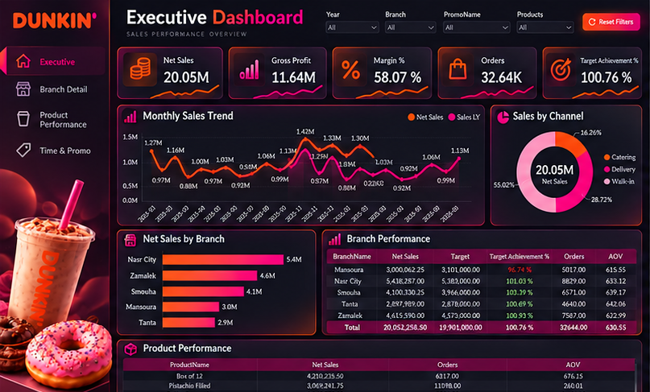
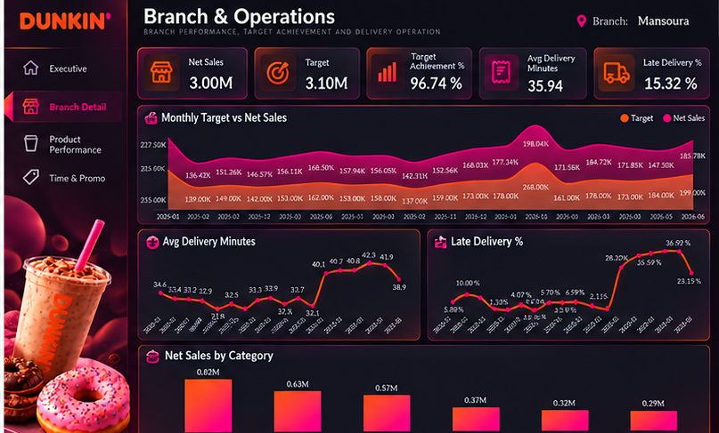
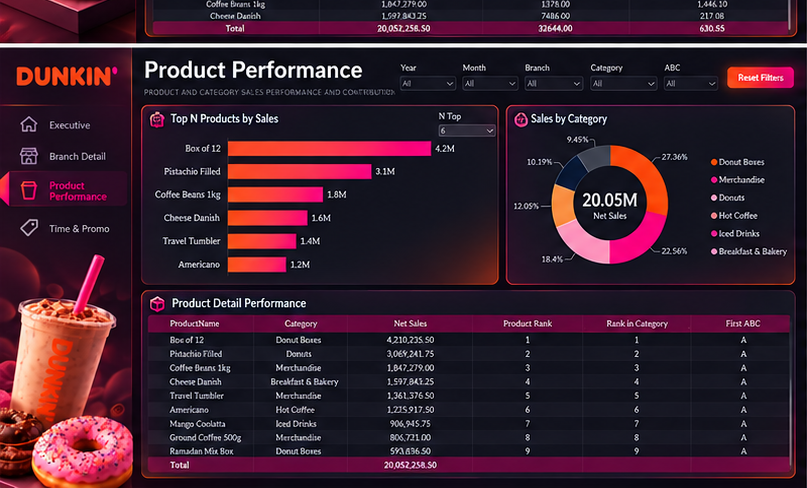
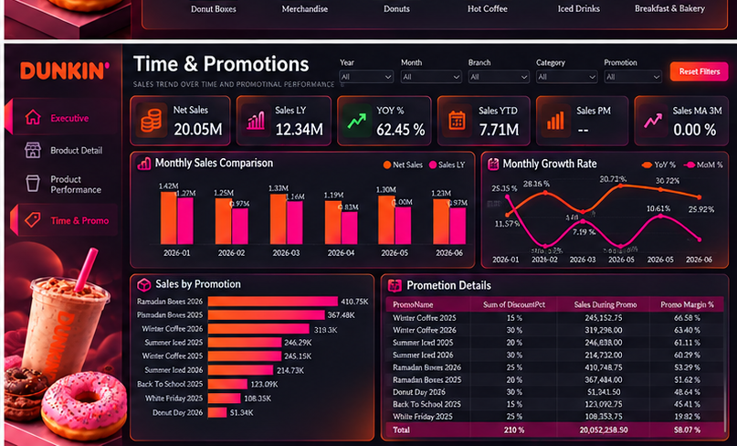

# Dunkin | Sales Performance Analytics

### Power BI Business Intelligence & Sales Analytics Portfolio

## Project Overview

A multi-page business intelligence project focused on analyzing Dunkin sales performance, branch operations, product contributions, and promotional trends.

The project combines financial KPIs, operational metrics, and interactive reporting concepts to support data-driven business decisions.

## Tools & Skills

- Microsoft Power BI
- Business Intelligence (BI)
- Sales Performance Analysis
- KPI Reporting
- Data Visualization
- Dashboard Design
- Business Performance Monitoring

## Dashboard Pages

### 1. Executive Dashboard

An executive-level overview of overall business performance, highlighting key financial and operational metrics.

**Key Analyses:**
- Net Sales and Gross Profit
- Profit Margin %
- Total Orders
- Target Achievement %
- Monthly Sales Trends
- Sales Distribution by Channel
- Branch Performance Comparison
- Product Performance Overview

---

### 2. Branch Detail | Operations Analytics

A detailed view of branch-level performance, focusing on sales targets, operational efficiency, and delivery performance.

**Key Analyses:**
- Branch Net Sales
- Sales Targets and Achievement %
- Monthly Target vs. Actual Sales
- Average Delivery Time
- Late Delivery %
- Sales by Product Category

---

### 3. Product Performance

An analytical view of product sales performance and category contributions.

**Key Analyses:**
- Top Products by Net Sales
- Sales Distribution by Category
- Product Rankings
- ABC Classification
- Detailed Product Performance

---

### 4. Time & Promotions

A performance analysis focused on sales trends over time and promotional campaign results.

**Key Analyses:**
- Monthly Sales Comparisons
- Year-over-Year Growth %
- Sales Year-to-Date
- Promotional Sales Performance
- Promotion Details and Discount Rates
- Promotional Profit Margin %

---

## Dashboard Design Preview

The dashboard images present the Dunkin Dark visual design direction for the project. The corresponding Power BI report implementation is being updated.

## Project Purpose

This project demonstrates the application of business intelligence and data visualization to explore retail sales performance, monitor operational KPIs, and communicate insights across multiple business areas.

## Repository Contents

This repository contains dashboard previews and project documentation. The underlying dataset and Power BI source file are not publicly distributed.
